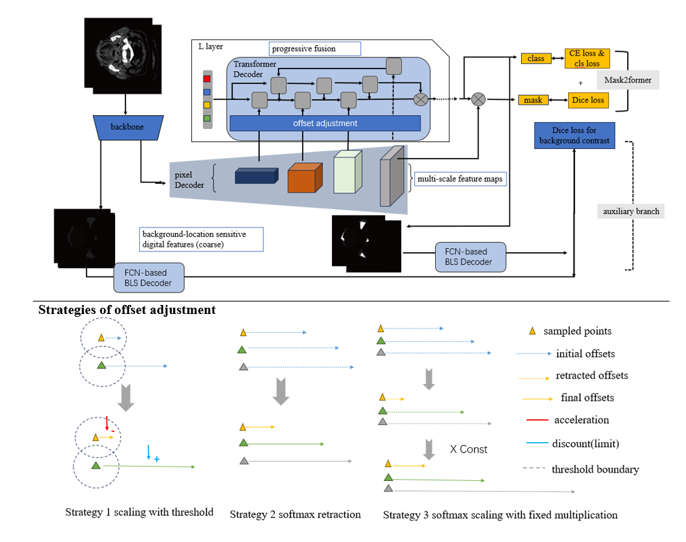
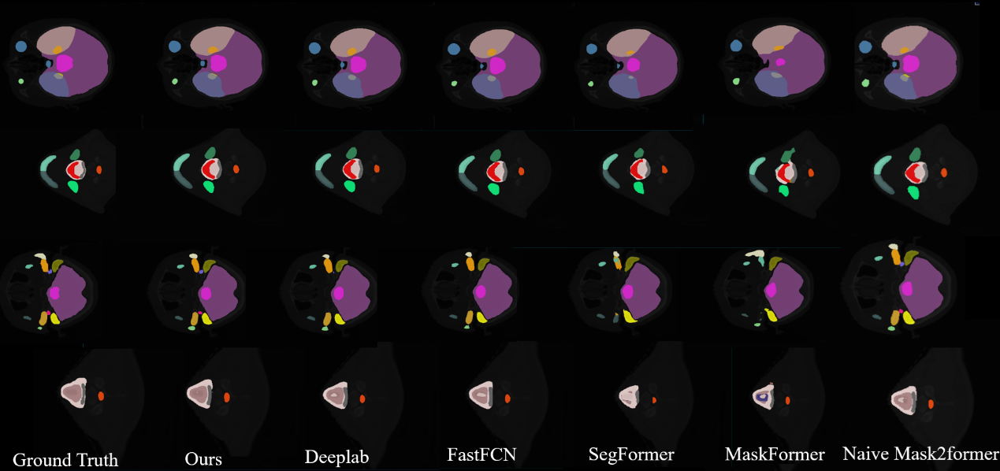

### Instructions for Model Training and Test Results

If you are interested, you can run the following command to train the model:
```bash
CUDA_VISIBLE_DEVICES=$GPU bash /mmsegmentation/tools/dist_train.sh $file 1
```
Here, `$file` refers to the configuration file path. We recommend using the following configuration file for training:
```
/mmsegmentation/configs/mask2former/sr_ormm_segrap_mask2former_r50_8xb2-160k_segrap-512x512.py
```
This configuration file incorporates an FCN auxiliary branch for segmentation refinement.

### Test Logs and Results

Our test logs are stored in the `tools/work_dirs` directory, which includes results using late fusion and the auxiliary branch. Below are the test results using late fusion, where background and overlapping regions were not counted:

| Class | Dice | Acc |
| --- | --- | --- |
| Brain | 97.77 | 97.07 |
| BrainStem | 92.63 | 93.71 |
| Chiasm | 65.09 | 74.58 |
| TemporalLobe_L | 93.87 | 94.42 |
| TemporalLobe_R | 94.68 | 93.15 |
| Hippocampus_L | 56.63 | 61.65 |
| Hippocampus_R | 50.31 | 60.0 |
| Eye_L | 97.29 | 95.16 |
| Eye_R | 96.7 | 94.25 |
| Lens_L | 80.18 | 84.51 |
| Lens_R | 83.55 | 83.13 |
| OpticNerve_L | 88.72 | 80.11 |
| OpticNerve_R | 89.69 | 81.61 |
| MiddleEar_L | 75.16 | 66.73 |
| MiddleEar_R | 78.85 | 70.28 |
| IAC_L | 84.48 | 82.61 |
| IAC_R | 83.01 | 86.33 |
| TympanicCavity_L | 85.81 | 77.06 |
| TympanicCavity_R | 87.98 | 81.58 |
| VestibulSemi_L | 86.29 | 76.53 |
| VestibulSemi_R | 83.62 | 73.34 |
| Cochlea_L | 89.35 | 89.26 |
| Cochlea_R | 87.7 | 85.52 |
| ETbone_L | 84.59 | 73.8 |
| ETbone_R | 85.86 | 75.86 |
| Pituitary | 79.46 | 81.36 |
| OralCavity | 96.47 | 93.73 |
| Mandible_L | 97.18 | 95.92 |
| Mandible_R | 96.58 | 94.88 |
| Submandibular_L | 95.21 | 91.08 |
| Submandibular_R | 94.42 | 89.57 |
| Parotid_L | 94.39 | 89.46 |
| Parotid_R | 96.35 | 93.24 |
| Mastoid_L | 97.13 | 94.62 |
| Mastoid_R | 96.98 | 94.3 |
| TMjoint_L | 94.43 | 89.65 |
| TMjoint_R | 93.88 | 90.37 |
| SpinalCord | 95.79 | 92.41 |
| Esophagus | 93.92 | 89.63 |
| Larynx | 87.2 | 82.83 |
| Larynx_Glottic | 81.59 | 78.33 |
| Larynx_Supraglot | 88.52 | 89.42 |
| PharynxConst | 90.79 | 84.31 |
| Thyroid | 94.33 | 90.66 |
| Trachea | 95.86 | 94.23 |
| None | nan | nan |

### Model Performance Comparison

Our offset-adjusted Mask2Former model, enhanced with an FCN auxiliary branch, has outperformed the state-of-the-art (SOTA) on both the HaN-seg and SegRap2023 datasets:

#### HaN-seg Dataset
| Model | mDice | mIoU |
| --- | --- | --- |
| SegReg (SOTA) | 81.26 | 69.05 |
| Ours | 81.601 | 70.43767 |

#### SegRap2023 Dataset
| Model | Used Data | mDice |
| --- | --- | --- |
| Y. Zhong et al. (SOTA) | CT and CT contrast | 86.60 |
| Ours* | CT only | 87.77 |

### Model Improvements

We have made additional modifications to the `encoder_decoder.py` file. For example, we implemented a two-stage segmentation process by introducing a new branch loss processing mechanism, as described in our paper. This paper is currently under revision for MICCAI and will be released soon. The scratch of our methods and the results are as follows.


